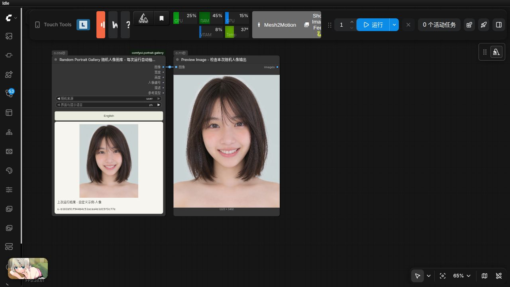
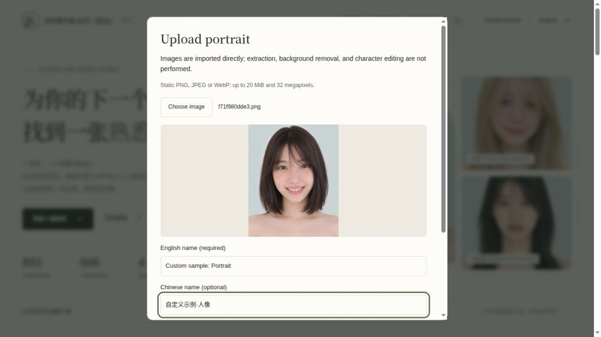
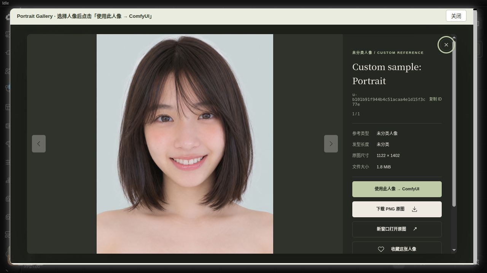

# comfyui-portrait-gallery

[简体中文](README.md) · **English**

A local portrait reference gallery for ComfyUI. Built-in assets, existing IDs and the node's 6 outputs remain compatible with existing workflows. See the [Chinese README](README.md) for the original dataset, examples, model configurations and source notices.


## Automatic random selection: a separate node

Add **image → Portrait Gallery → Random Portrait Gallery**, connect `image` to your workflow or Preview Image, and run. Each execution draws a new reference automatically. Set `origin` to `all`, `builtin` or `user`. The default pool includes faces, styling references and custom portraits; entries are not assumed to share an identity.

The original **PortraitGallery** keeps its inputs, fixed-selection behavior, cache and 6 output sockets. The new node uses those same outputs for one actual selected image and displays its executed ID and preview. Its `language` controls the new UI, errors and user-entered preview names; port values retain the original node's semantics without invented translations.

Draws may repeat by chance and are independent of gallery filters. Missing originals are skipped; an empty usable source raises a clear error. Saved preview IDs never freeze future draws. To keep a result, copy `portrait_id` into the original selector. The random node does not enqueue or start tasks itself.

Import [the random portrait preview example](example_workflows/random_portrait_preview.json); a matching API graph is included.




## Install and browse

Clone `https://github.com/wangweihong/comfyui-portrait-gallery.git` inside `ComfyUI/custom_nodes/`, keep its bundled `library/`, restart ComfyUI and refresh the browser. Dependencies use ComfyUI's Pillow, NumPy, PyTorch and aiohttp; uploads require no generation model. Add **image → Portrait Gallery**, open its Browse button, inspect an image and click Use to write it back. Browsing or selecting never queues a workflow.

## Upload one custom portrait

1. Click **Upload portrait** in the standalone gallery or the gallery opened from a node. The new upload controls provide a Chinese / English selector; legacy built-in browsing labels remain Chinese.
2. Choose one finished reference image, inspect the preview and enter a name. The other-language name is optional; if omitted, the supplied name is reused without inventing a translation.
3. Click **Save to gallery**. Success selects the Custom source, clears existing filters and opens the new image viewer.
4. Click Use in the image viewer to update the current node. Uploading and selecting do not run the workflow.

Reference type can be Unspecified, Face or Styling; hair length is optional and defaults to Unspecified. Source portrait IDs, Japanese descriptions and identity pairings are not invented.

Static PNG, JPEG and WebP are supported, one image at a time, up to **20 MiB and 32 megapixels**. The server validates actual content and rejects animation, damaged images and paths outside the library. Full images are normalized to PNG while preserving dimensions and transparency. WebP previews fit within 800×1000 and thumbnails within 400×500, without stretching. Node IMAGE outputs composite transparency onto white. **Import does not extract a subject, remove backgrounds or edit people.** This version does not include batch import, editing or deletion.

## Persistent user library

Custom assets are stored at **`ComfyUI/user/portrait_gallery/`**, independently of node code and built-in assets. Node upgrades do not overwrite this directory; back it up separately.

- `data/custom.json` stores stable `u-` + UUID IDs, user-entered names, classifications, original filename, dimensions, upload time and checksum.
- img/full/ (PNG), img/preview/ (WebP), img/thumb/ (WebP) contain full images, previews and thumbnails with matching IDs.
- Set `COMFYUI_PORTRAIT_GALLERY_USER_LIBRARY` to override storage with a persistent writable directory visible inside the container/environment.
- Clients of this single-machine ComfyUI service share the library; no account or multi-user permissions are added.

**All sources / Built-in / Custom** filters have separate counts. Custom uploads remain available when the built-in index is missing. Custom `portrait_id` values use the new stable IDs; source_id metadata is empty. Existing 6 outputs and original IDs stay compatible.

## API and verification

`POST /portrait_gallery/upload` accepts multipart `image`, `name`, optional `other_name` and `language` (zh/en). Portrait metadata: optional section (custom/face/styling) and hair (unknown/short/medium/medium-long/long). HTTP201 returns a record and refreshed catalog with records and meta. Failures return JSON error codes; index writes are locked and atomic, and incomplete new files are rolled back. Existing `GET /portrait_gallery/catalog` retains its array response with origin=builtin/user. `GET /portrait_gallery/meta` reports counts and a missing built-in library. Asset reads remain restricted to registered paths.

```bash
python3 -m unittest discover -s tests -v
node --check web/custom_upload.mjs
node --test tests/test_random_frontend.cjs
```





Independent program code retains its existing license. Built-in images and source data retain their original terms; consult the source and license notices linked from the [Chinese README](README.md). Custom uploads are not attributed to the built-in dataset.
