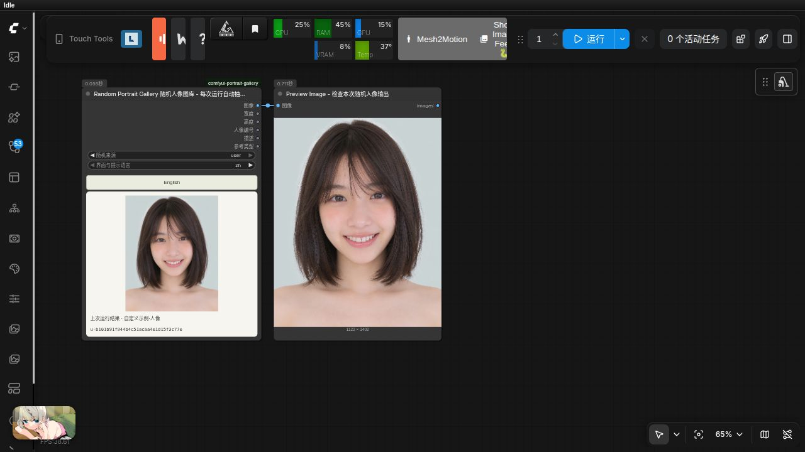
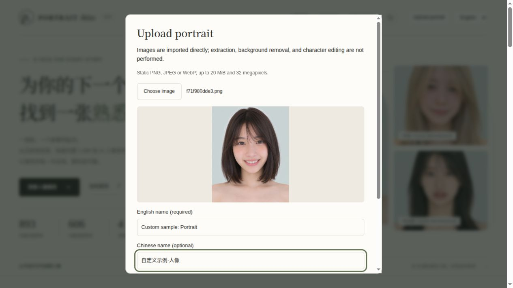
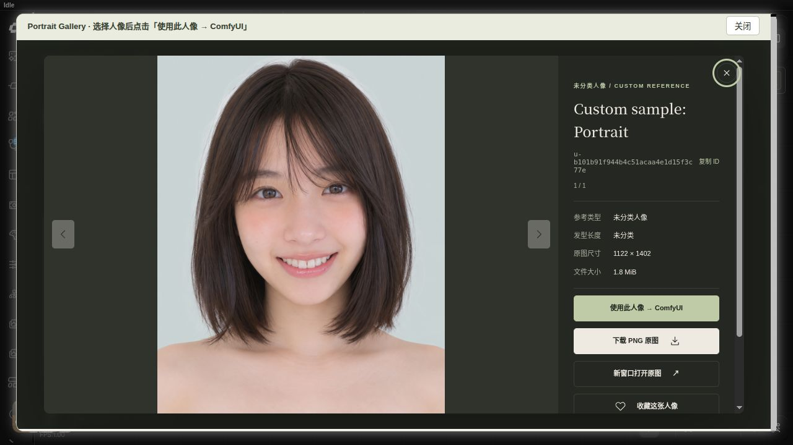

# comfyui-portrait-gallery

[简体中文](README.md) · **English**

A local portrait reference gallery for ComfyUI. Built-in assets, existing IDs and the node's 6 outputs remain compatible with existing workflows. See the [Chinese README](README.md) for the original dataset, examples, model configurations and source notices.


## Automatic random selection: a separate node

Add **image → Portrait Gallery → Random Portrait Gallery**, connect `image` to your workflow or Preview Image, and run. While unlocked, each execution draws a new reference automatically. Set `origin` to `all`, `builtin` or `user`. The default pool includes faces, styling references and custom portraits; entries are not assumed to share an identity.

The original **PortraitGallery** keeps its required ID input and first 6 output sockets, adds an optional `language` input, and appends a seventh `portrait` name output. The new node uses those same outputs for one actual selected image and displays its executed ID and preview. Both nodes use `language` for the whole gallery, details, descriptions, and `portrait` names. Set `en` for English text outputs or `zh` for Chinese, then run again to update output values.

Click **🎲 Random** to draw and preview a portrait using the node's source and reference-type filters, without running the workflow. The dice skips the current image when alternatives exist. Enable **🔒 Lock random selection** to disable the dice and keep the current `portrait_id` and all its outputs for subsequent runs. The workflow saves the lock and selected ID. Draw once before locking. Changing filters while locked keeps the selection; missing or cleaned originals raise an error rather than drawing a replacement.

Unlock to restore automatic random draws on workflow runs, which may repeat by chance. An unlocked manual preview does not fix the next workflow draw. Missing or cleaned originals are excluded; an empty usable source raises an error. The node does not enqueue or start workflow tasks itself.


Import [the random portrait preview example](example_workflows/random_portrait_preview.json); a matching API graph is included.

Random Pose also accepts optional `pose_system` and `angle` filters. Random Portrait accepts `section` (`face` / `styling` / `custom`). Filters default to `all`, preserving existing random workflows.




## Qwen Image 2.1 gallery workflows

The obsolete workflow examples have been replaced and renamed to describe their actual behavior.

- [01 · Face/outfit replacement followed by pose editing](example_workflows/01_QwenImage2.1_换脸换装与姿态编辑_两阶段.json) ([API](example_workflows/01_QwenImage2.1_换脸换装与姿态编辑_两阶段.api.json)): requires the pose, portrait and costume galleries. Stage two uses pose image 1 and the decoded stage-one person image 2, with a dedicated PoseStudio QI2.1 v2 model-only LoRA branch at strength 1.
- [02 · Three-reference face and outfit replacement](example_workflows/02_QwenImage2.1_换脸换装_三图参考.json) ([API](example_workflows/02_QwenImage2.1_换脸换装_三图参考.api.json)): original person image 1, costume image 2, target portrait image 3. Requires only the portrait and costume galleries; no MOSS, depth estimator, pose stage, or pose LoRA.

Copy the [bundled person PNG](example_workflows/assets/h3_bfs_original_teal_character_20261014.png) to `ComfyUI/input/`, or select your own image. Re-select model paths locally. Both use 25 steps, CFG 1, Euler/simple and seed 2026103002; 01 runs this twice. The full two-stage workflow was tested successfully, and its stage-one RGB pixels matched the pre-repair output exactly. The current P003 pose follows the rear three-quarter turn, over-shoulder look and hand-on-waist placement. Other poses and fine details remain subject to visual review. See the [dependency and input-order guide](example_workflows/qwen21_gallery_workflows.md).

## Install and browse

Clone `https://github.com/wangweihong/comfyui-portrait-gallery.git` inside `ComfyUI/custom_nodes/`, keep its bundled `library/`, restart ComfyUI and refresh the browser. Dependencies use ComfyUI's Pillow, NumPy, PyTorch and aiohttp; uploads require no generation model. Add **image → Portrait Gallery**, open its Browse button, inspect an image and click Use to write it back. Browsing or selecting never queues a workflow.

## Upload one custom portrait

1. Click **Upload portrait** in the standalone gallery or the gallery opened from a node. The new upload controls provide a Chinese / English selector; all built-in filters and details also switch languages.
2. Choose one finished reference image, inspect the preview and enter a name. The other-language name is optional; if omitted, the supplied name is reused without inventing a translation.
3. Click **Save to gallery**. Success selects the Custom source, clears existing filters and opens the new image viewer.
4. Click Use in the image viewer to update the current node. Uploading and selecting do not run the workflow.

Reference type can be Unspecified, Face or Styling; hair length is optional and defaults to Unspecified. Source portrait IDs, Japanese descriptions and identity pairings are not invented.

Static PNG, JPEG and WebP are supported, one image at a time, up to **20 MiB and 32 megapixels**. The server validates actual content and rejects animation, damaged images and paths outside the library. Full images are normalized to PNG while preserving dimensions and transparency. WebP previews fit within 800×1000 and thumbnails within 400×500, without stretching. Node IMAGE outputs composite transparency onto white. **Import does not extract a subject, remove backgrounds or edit people.** Custom uploads do not yet support batch import, editing or deletion. Built-in assets can be deleted or replaced using Edit.

## Persistent user library

Custom assets are stored at **`ComfyUI/user/portrait_gallery/`**, independently of node code and built-in assets. Node upgrades do not overwrite this directory; back it up separately.

- `data/custom.json` stores stable `u-` + UUID IDs, user-entered names, classifications, original filename, dimensions, upload time and checksum.
- img/full/ (PNG), img/preview/ (WebP), img/thumb/ (WebP) contain full images, previews and thumbnails with matching IDs.
- Set `COMFYUI_PORTRAIT_GALLERY_USER_LIBRARY` to override storage with a persistent writable directory visible inside the container/environment.
- Clients of this single-machine ComfyUI service share the library; no account or multi-user permissions are added.

**All sources / Built-in / Custom** filters have separate counts. Custom uploads remain available when the built-in index is missing. Custom `portrait_id` values use the new stable IDs; source_id metadata is empty. Existing 6 outputs and original IDs stay compatible.

## API and verification

`POST /portrait_gallery/upload` accepts multipart `image`, `name`, optional `other_name` and `language` (zh/en). Portrait metadata: optional section (custom/face/styling) and hair (unknown/short/medium/medium-long/long). HTTP201 returns a record and refreshed catalog with records and meta. Failures return JSON error codes; index writes are locked and atomic, and incomplete new files are rolled back. Existing `GET /portrait_gallery/catalog` retains its array response with origin=builtin/user. `GET /portrait_gallery/meta` reports counts and a missing built-in library. Asset reads remain restricted to registered paths.

```bash
python3 -m unittest discover -s tests -v
node --check web/custom_upload.mjs
node --test tests/test_random_frontend.cjs
```





Independent program code retains its existing license. Built-in images and source data retain their original terms; consult the source and license notices linked from the [Chinese README](README.md). Custom uploads are not attributed to the built-in dataset.

The `portrait` output contains only the selected reference name. Portraits without detailed style names use the recorded hair length and reference type; no personal name is invented. Uploaded references use the supplied name for the selected language. Existing output connections remain compatible. The gallery GitHub link points to this repository.

## Delete and replace built-in assets

- Click **Edit**, select cards and choose **Delete selected assets**. Existing filters and select-all apply to the current results. Assets are independent; matching names or source IDs are never grouped. Custom uploads are excluded.
- **Delete** and **Replace** appear below **Open in new window** in the viewer. Deletion removes the asset files and frees storage. Replacement accepts static PNG/JPEG/WebP, up to 20 MiB and 32 megapixels, preserves the ID and metadata, and updates all image derivatives.
- **Manage built-in assets** is only for handling earlier changes after a plugin update. Choose independently whether to repeat deletions and use replacement images, then **Apply**. No image selection is needed. Reports include deleted, replaced, kept and failed assets. Keeping built-ins stops the matching earlier action; missing restored files produce an error and retain the record for retry.

Startup, browsing and updates never automatically delete or replace files. Records live in `ComfyUI/user/portrait_gallery/data/builtin_changes.json`; replacement sources live in `ComfyUI/user/portrait_gallery/replacements/<id>/<revision>/`. Back up both. Clients of the same service share these files. Replacement sources and older revisions are retained. Working-tree deletion does not remove Git history objects.

Deleted IDs produce clear errors in fixed workflows and are excluded from random sampling. Replacements keep IDs and update node images. Operations are restricted to registered built-in paths and reject symlinks and path traversal. Restart ComfyUI after deployment and refresh the page. New controls remain hidden until their backend is available.

API: `GET /portrait_gallery/manage/summary`; `POST /portrait_gallery/manage/plan` with `{ids, mode}` or `{choices: {deleted: "delete" / "keep", replaced: "replace" / "keep"}}`; `POST /portrait_gallery/manage/apply` with `{request, token}`; multipart `POST /portrait_gallery/manage/replacement` with `id` and `image`.
