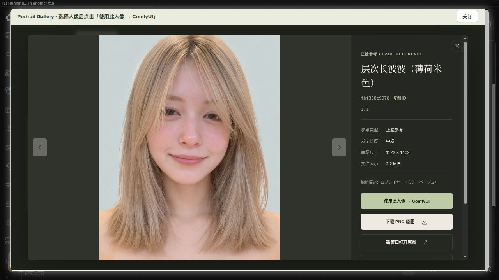
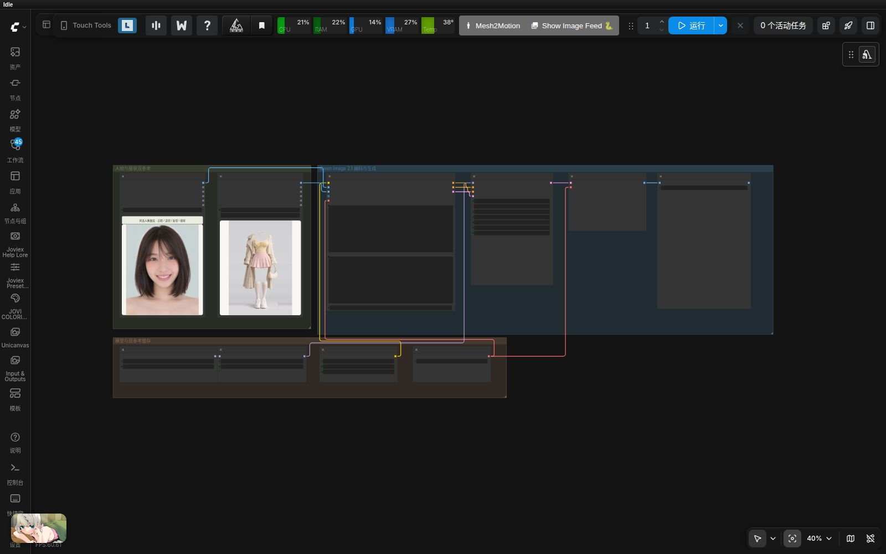
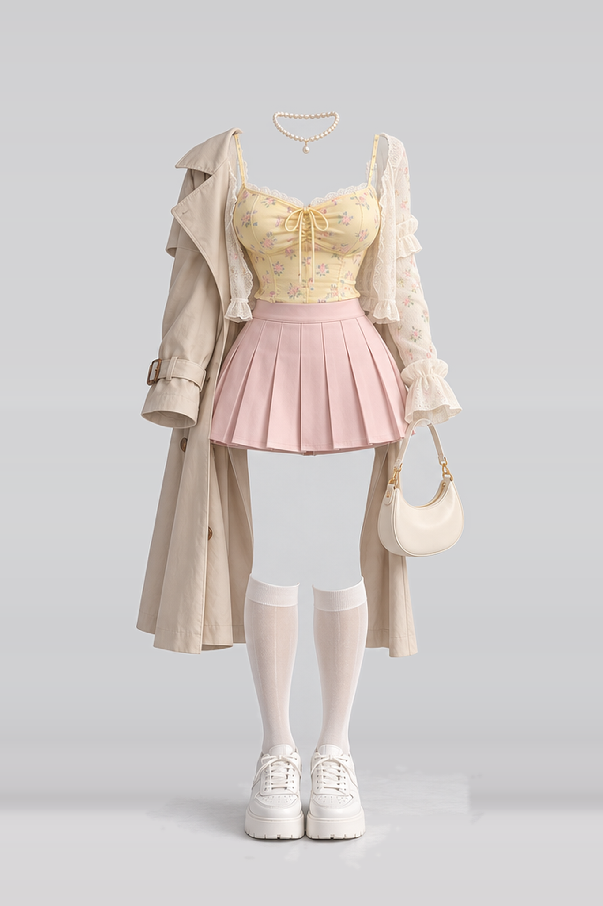
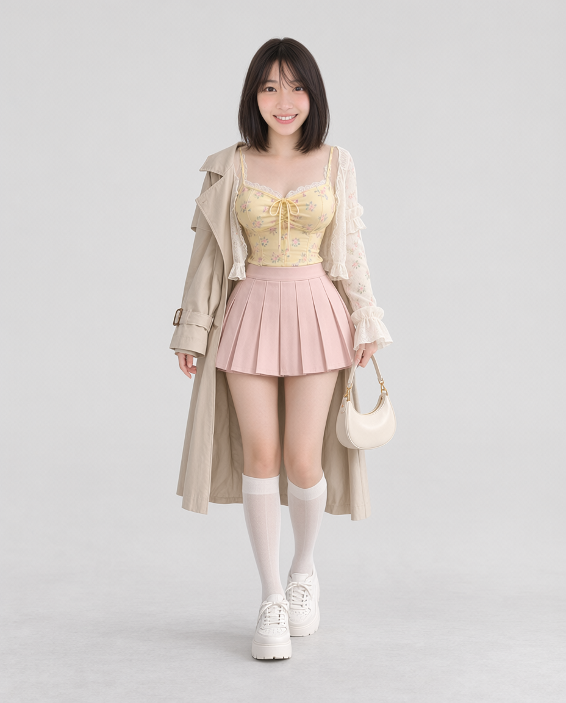
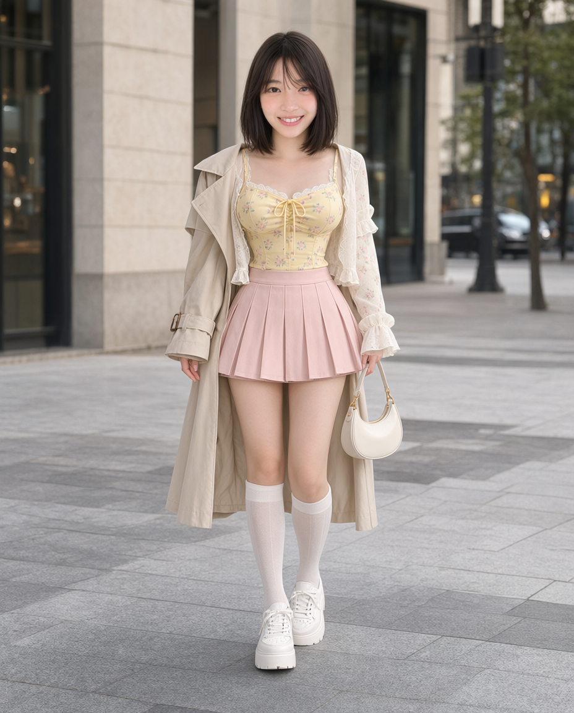

# comfyui-portrait-gallery

**简体中文** · [English](README.en.md)

ComfyUI 本地中文人像图库节点，提供与 `ai-portrait-gallery-zh` 一致的暖色画廊展示。包含 **1,499 张 PNG 原图和 1,499 张 WebP 缩略图**：893 张正脸、606 张造型，支持类型、发型长度、50 种风格、中文/日文/ID 搜索、收藏与大图预览。




## 每次运行随机：独立节点

添加 **image → Portrait Gallery → Random Portrait Gallery 随机人像图库**，将 `image` 接入后续工作流或 Preview Image。每次执行会重新随机抽取一张原图，无需点击随机按钮。`origin` 可选 `all`（全部）、`builtin`（内置）或 `user`（自定义）。默认范围包含正脸、造型及自定义人像；不假定不同条目属于同一人物。

原 **PortraitGallery** 的输入、固定选图、缓存、6个输出和连线均保持不变。新节点沿用这6个输出，所有数据对应同一张实际抽中的素材；执行后显示编号和预览。新节点的 `language` 切换界面、提示及自定义预览名称语言，端口数据仍沿用原节点语义，不补造内置描述的译文。

抽样可能偶然重复，不受浏览页面筛选影响；缺失原图会跳过，无可用图片时明确报错。保存的预览编号不参与下次抽样。需要固定结果时，将输出 `portrait_id` 填入原节点。新节点本身不会启动或追加任务。

导入 [随机人像预览示例](example_workflows/random_portrait_preview.json)，附同名 API 工作流。


## 单张上传自定义人像

1. 在独立图库或节点内嵌图库的顶部点击 **上传人像**。
2. 选择一张现成参考图，查看预览，填写名称。另一语言名称可选；未填写时沿用已有名称，不自动翻译。顶部 **中文 / English** 切换新增上传控件、提示和自定义名称的语言，原有内置图库浏览标签保持中文。
3. 点击 **保存到图库**。成功后切换到“自定义”来源，清除分类、搜索等筛选，并打开新素材的大图。
4. 在大图中点击 **使用此人像 → ComfyUI**，写回当前节点；上传和选择都不会自动运行或排队。

参考类型可选：未分类、正脸或造型；发长可选，默认未分类。不补造来源人物编号、原始日文描述或人物配对关系。

支持静态 PNG、JPEG、WebP，一次一张，限制 **20 MiB、3200 万像素**。服务端检查实际内容，拒绝动画、损坏图片和越界路径。完整图片转为 PNG，保留尺寸和透明度；生成 800×1000 内的 WebP 预览、400×500 内的 WebP 缩略图。节点 IMAGE 输出的透明部分合成白色。上传仅导入图片，**不自动提取、抠图、去背景或修改人物**。第一版不含批量导入、编辑和删除。

自定义数据保存在 **`ComfyUI/user/portrait_gallery/`**，独立于节点代码与内置素材；升级代码不会覆盖：

- `data/custom.json`：稳定 `u-` + UUID 编号、中英文名称、分类、原文件名、尺寸、上传时间和校验值。
- img/full/（PNG）、img/preview/（WebP）、img/thumb/（WebP）：完整图、预览与缩略图，按同一编号对应。
- 备份时请单独备份此用户目录。本地 ComfyUI 服务的客户端共享该库，没有账号或多用户权限隔离。
- 可用 `COMFYUI_PORTRAIT_GALLERY_USER_LIBRARY` 指定其他持久化、可写且容器内可见的目录。

新增 **全部来源 / 内置 / 自定义** 筛选与独立数量统计；缺少内置索引时仍可上传与使用自定义素材。保留现有 **6 个输出**、旧编号和连线兼容；自定义编号用于 `portrait_id`，`source_id` 元数据为空，不冒用原站编号。

接口：`POST /portrait_gallery/upload`，multipart 字段 `image`、`name`，可选 `other_name`、`language`（zh/en）, `section`（custom/face/styling）、`hair`（unknown/short/medium/medium-long/long）。成功返回201及 `record`、包含 `records` 和 `meta` 的 `catalog`；失败返回错误代码。索引加锁并原子替换，失败回滚本次新文件。`GET /portrait_gallery/catalog` 保持数组格式，并增加 `origin=builtin/user`；`GET /portrait_gallery/meta` 提供数量与缺失状态。图片接口只读取索引中登记的文件。


## 安装与使用

1. 在 `ComfyUI/custom_nodes/` 执行 `git clone https://github.com/wangweihong/comfyui-portrait-gallery.git`，或将整个节点文件夹放入该目录，保留 `library/` 素材库；重启 ComfyUI 并刷新浏览器。仓库包含全部素材，首次克隆约需下载 4.55 GiB 图片，无需再上传或解压部署 ZIP。
2. 添加 **image → Portrait Gallery → Portrait Gallery 人像图库**。
3. 点击 **浏览人像图库 · 正脸 / 造型 / 发型 / 搜索**。
4. 浏览或搜索，打开大图，点击 **使用此人像 → ComfyUI**。选择只写回当前节点，不自动运行。
5. 节点显示所选 PNG 原图。将 `image` 输出连接到图像参考工作流，手动点击运行。

`example_workflows/portrait_gallery_preview.json` 是可直接导入的原图预览与保存流程。所有示例均附同名 `.api.json`。

素材、元数据和页面均从本地读取，没有统计或运行时下载。人像与造型是原站独立集合，不代表同一人物成对对应。原站没有风格描述的记录不补造内容。

## 输出

| 输出 | 类型 | 内容 |
| --- | --- | --- |
| image | IMAGE | 完整 PNG 原图，RGB，透明处合成白色，保持原尺寸 |
| width / height | INT | 输出宽高 |
| portrait_id | STRING | 选定人像 ID |
| description | STRING | 中文参考类型、发型及原站已有的风格描述 |
| section | STRING | 正脸参考 / 造型参考 |

高级：环境变量 `COMFYUI_PORTRAIT_GALLERY_LIBRARY` 可指定其他完整图库根目录。服务端仅允许索引中登记的图片，拒绝路径穿越、未知 ID 和指向图库外的符号链接。

## 当前推荐：只用 Qwen Image 2.1 完成人物换装

导入 [`example_workflows/qwen21_portrait_outfit.json`](example_workflows/qwen21_portrait_outfit.json)，或使用对应的 [API 图](example_workflows/qwen21_portrait_outfit.api.json)。需要同时安装 [comfyui-costume-gallery](https://github.com/wangweihong/comfyui-costume-gallery)。

- **图1：Portrait Gallery 人像图库**，只提供人物身份、五官与发型。
- **图2：Costume Gallery 服装图库**，提供衣服、颜色、材质和搭配层次。
- **Qwen Image 2.1** 根据两张图重新构建协调的全身人物，再适配服装；不使用 MOSS、姿势图库或深度控制。

提示词明确区分头像参考和全身构图：不要沿用头像特写的头部占比，统一构建头部、肩颈、躯干、骨盆与四肢尺度，再让衣服的肩线、袖长、腰线和衣摆服从人体。人物与服装可通过两个图库节点更换；场景和动作可自行修改。



### 实际生成效果

下列图片由本机 Qwen Image 2.1 实际生成。固定种子 `2026103002`，25 步、CFG 1、Euler/simple、双参考分辨率 1024，输出 928×1152；没有对结果进行局部合成或修图。

| 人物参考（图1） | 服装参考（图2） | 自然比例提示词结果 |
| --- | --- | --- |
|  |  |  |

| 简短提示词原结果 | 明确参考职责与人体尺度后 |
| --- | --- |
|  |  |

[另一版通用英文提示词的实测结果](docs/images/qwen_alternative.png)。这些是特定参考图和种子的示例；模型仍可能改变场景、发型、配饰或叠穿关系，不能保证精确身份和服装细节完全一致。

## 可选示例：MOSS 指定姿势 → Qwen Image 2.1 换脸

完整示例：`example_workflows/01_MOSS姿态服装_Qwen21人像换脸.json`。

1. **Pose Gallery** 选姿势，Depth Anything V2 估计深度图，等比缩放到约 1 MP，供 MOSS 深度控制。
2. **Costume Gallery** 选衣服。PNG 通过 MOSS 视觉文本编码器作为服装参考，英文关键词自动拼入提示词；不把服装平铺图作为人物深度图。
3. **MOSS SFT** 生成指定姿势和服装的人物照片，保存第一阶段结果。
4. **Portrait Gallery** 选目标脸。Qwen Image 2.1 的图一是 MOSS 成图，图二是人像原图；提示词要求只替换面部身份，保留图一的姿势、发型、服装、光照与场景。

两阶段均使用通用提示词，不写死性别、年龄、发型、背景或具体动作。服装关键词和姿势描述随图库选择自动读取，切换素材无需改写提示词。Qwen 只按两张图的职责执行换脸，不加局部合成或针对某张图的修补分支。

全部保存节点使用 `images/qwen/gallery/` 前缀：深度图在 `depth/`，MOSS 中间图在 `moss/`，最终换脸图在 `results/`。相对位置从 `ComfyUI/output/` 开始；本次实测另外同步到工作区同名目录。

### 本机模型配置

| 类型 | 本机选择值 |
| --- | --- |
| MOSS diffusion model | `moss/moss_image_sft_bf16.safetensors` |
| MOSS depth LoRA | `moss/moss_image_color_depth_control.safetensors` |
| MOSS text encoder | `moss/qwen3.5_9b_int8_convrot.safetensors` |
| MOSS VAE | `moss/flux2-vae.safetensors` |
| 深度预处理 | `depth_anything_v2_vitl.pth` |
| Qwen diffusion model | `image2image/qwen_image_2.1_bf16.safetensors` |
| Qwen text encoder | `text_encoders/qwen3vl_8b_bf16.safetensors` |
| Qwen VAE | `vae/qwen_image_2.1_vae_bf16.safetensors` |

MOSS：ER-SDE 50 步、CFG 3、simple 调度、shift 5、SLG 第 24 层、TSR 0.95、深度强度 0.65、结束位置 0.7。Qwen：基础 BF16、25 步、CFG 1、Euler/simple，缓存 auto/default，**不叠加 PoseStudio 或 Turbo LoRA**。模型不包含在本节点素材库中，其他机器需重选已安装模型。

这是生成式参考图编辑流程；MOSS 的衣服细节和 Qwen 的身份、表情保留程度需以实际结果检查，不是逐像素不变的严格换脸算法。

## 本地素材与维护

`library/data/` 为原始及中文清单，`library/img/full/` 为 PNG，`library/img/thumb/` 为 WebP，`library/SOURCE.json` 记录来源。原图与缩略图共约 4.55 GiB；本机安装优先使用硬链接共享已有素材，不额外复制部署 ZIP 或 `dist/`。

如果素材目录缺失，可从已经完整下载的项目补齐：

```bash
python3 scripts/install_library.py --source /绝对路径/ai-portrait-gallery-zh
```

依赖直接使用 ComfyUI 自带的 Pillow、NumPy、PyTorch、aiohttp，无额外推理模型依赖。

```bash
python3 -m unittest discover -s tests -v
node --check web/portrait_gallery.js
node --check web/app.mjs
```

图片与元数据来源：[AI モデル顔データベース](https://ai-portrait-gallery.pages.dev/)，原作者 [あぎ](https://x.com/agi_aibusi)。完整来源和适用范围见 `THIRD_PARTY_NOTICES.md`；独立代码的 MIT 许可不改变第三方素材条款。

```bash
node --test tests/test_random_frontend.cjs
```
