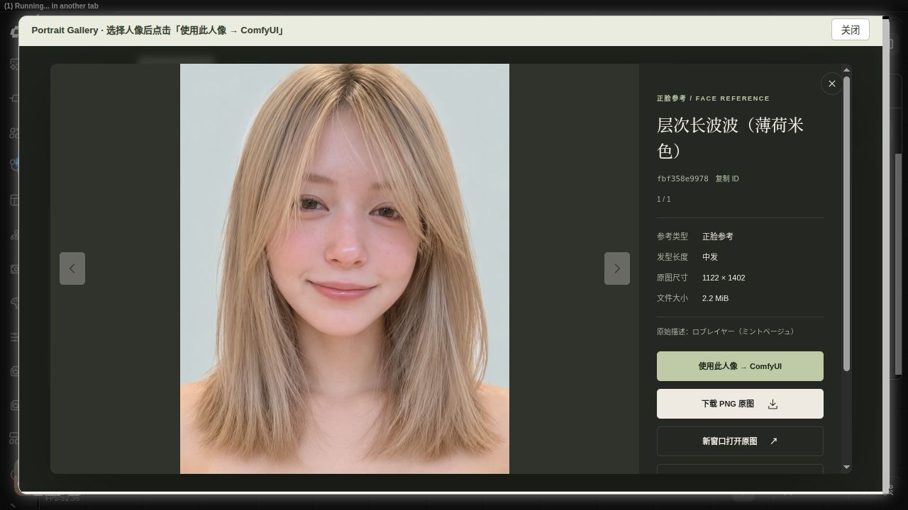
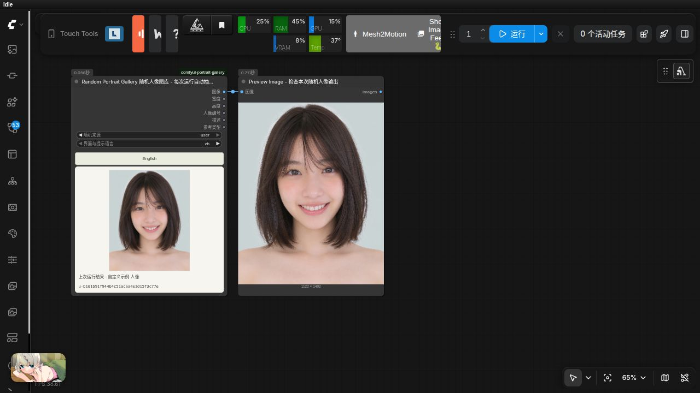
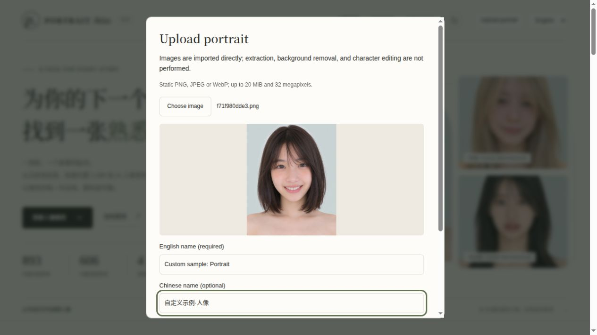
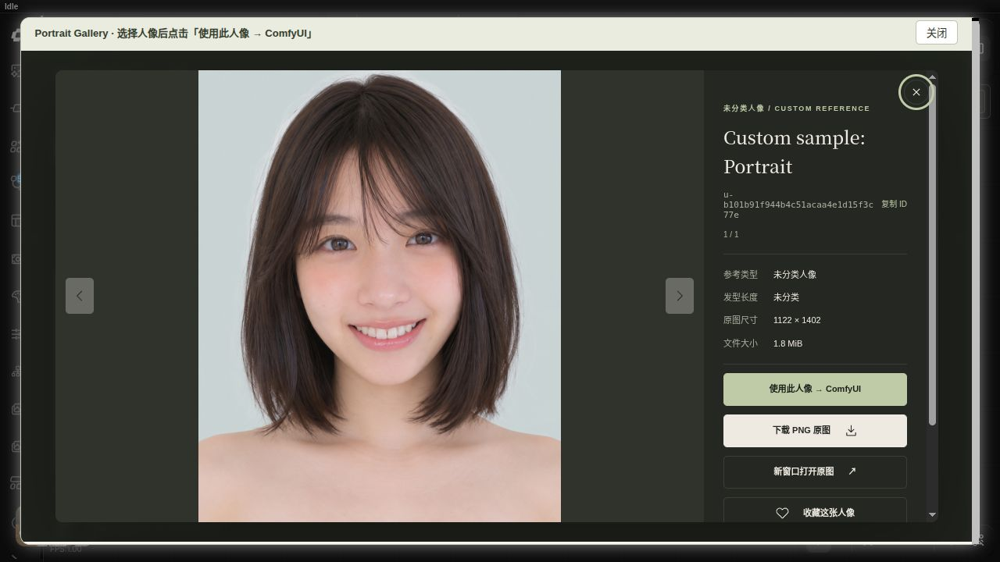
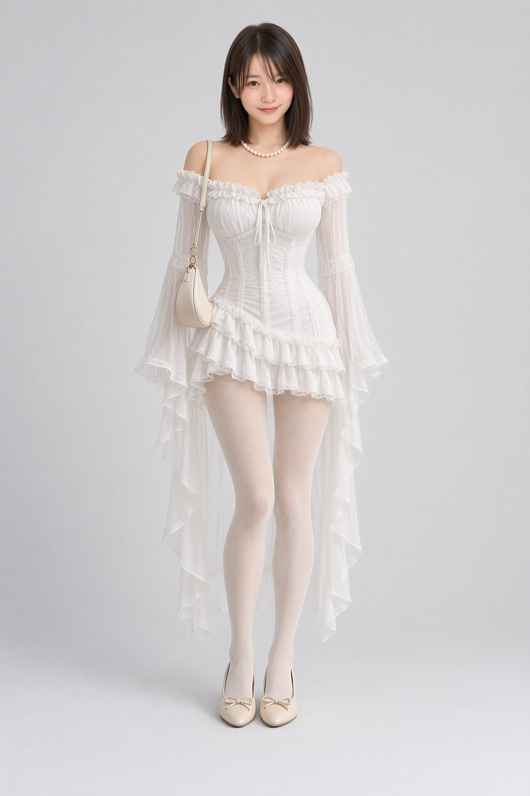
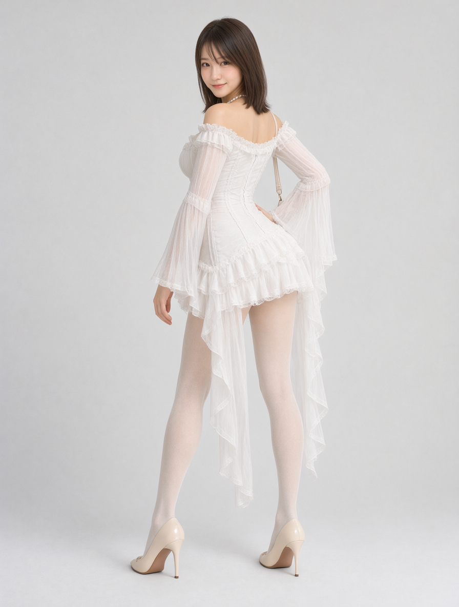

# comfyui-portrait-gallery

**简体中文** · [English](README.en.md)

ComfyUI 本地中文人像图库节点，提供与 `ai-portrait-gallery-zh` 一致的暖色画廊展示。包含 **1,499 张 PNG 原图和 1,499 张 WebP 缩略图**：893 张正脸、606 张造型，支持类型、发型长度、50 种风格、中文/日文/ID 搜索、收藏与大图预览。




## 每次运行随机：独立节点

添加 **image → Portrait Gallery → Random Portrait Gallery 随机人像图库**，将 `image` 接入后续工作流或 Preview Image。每次执行会重新随机抽取一张原图，无需点击随机按钮。`origin` 可选 `all`（全部）、`builtin`（内置）或 `user`（自定义）。默认范围包含正脸、造型及自定义人像；不假定不同条目属于同一人物。

原 **PortraitGallery** 保留原有必填输入及前 6 个输出，新增可选 `language` 输入，并在最后追加 `portrait` 名称输出。随机节点使用相同的 7 个输出。所有数据对应同一张实际抽中的素材；执行后显示编号和预览。两个节点的 `language` 同时控制界面、详情、描述及 `portrait` 名称输出；英文模式使用已收录的英文元数据。

抽样可能偶然重复，不受浏览页面筛选影响；缺失原图会跳过，无可用图片时明确报错。保存的预览编号不参与下次抽样。需要固定结果时，将输出 `portrait_id` 填入原节点。新节点本身不会启动或追加任务。

导入 [随机人像预览示例](example_workflows/random_portrait_preview.json)，附同名 API 工作流。

随机姿势新增可选 `pose_system`（体系）和 `angle`（视角）；随机人像新增 `section`（`face` / `styling` / `custom`）。这些筛选默认 `all`，旧随机流程行为不变。




## 单张上传自定义人像

1. 在独立图库或节点内嵌图库的顶部点击 **上传人像**。
2. 选择一张现成参考图，查看预览，填写名称。另一语言名称可选；未填写时沿用已有名称，不自动翻译。顶部 **中文 / English** 切换整张图库页面、筛选项、详情、帮助和上传控件，并同步节点的文本输出语言；切换后重新运行以更新输出。
3. 点击 **保存到图库**。成功后切换到“自定义”来源，清除分类、搜索等筛选，并打开新素材的大图。
4. 在大图中点击 **使用此人像 → ComfyUI**，写回当前节点；上传和选择都不会自动运行或排队。

参考类型可选：未分类、正脸或造型；发长可选，默认未分类。不补造来源人物编号、原始日文描述或人物配对关系。

支持静态 PNG、JPEG、WebP，一次一张，限制 **20 MiB、3200 万像素**。服务端检查实际内容，拒绝动画、损坏图片和越界路径。完整图片转为 PNG，保留尺寸和透明度；生成 800×1000 内的 WebP 预览、400×500 内的 WebP 缩略图。节点 IMAGE 输出的透明部分合成白色。上传仅导入图片，**不自动提取、抠图、去背景或修改人物**。第一版不含批量导入、编辑和删除。

自定义数据保存在 **`ComfyUI/user/portrait_gallery/`**，独立于节点代码与内置素材；升级代码不会覆盖：

- `data/custom.json`：稳定 `u-` + UUID 编号、中英文名称、分类、原文件名、尺寸、上传时间和校验值。
- img/full/（PNG）、img/preview/（WebP）、img/thumb/（WebP）：完整图、预览与缩略图，按同一编号对应。
- 备份时请单独备份此用户目录。本地 ComfyUI 服务的客户端共享该库，没有账号或多用户权限隔离。
- 可用 `COMFYUI_PORTRAIT_GALLERY_USER_LIBRARY` 指定其他持久化、可写且容器内可见的目录。

新增 **全部来源 / 内置 / 自定义** 筛选与独立数量统计；缺少内置索引时仍可上传与使用自定义素材。保留现有 **6 个输出**、旧编号和连线兼容；自定义编号用于 `portrait_id`，`source_id` 元数据为空，不冒用原站编号。

接口：`POST /portrait_gallery/upload`，multipart 字段 `image`、`name`，可选 `other_name`、`language`（zh/en）, `section`（custom/face/styling）、`hair`（unknown/short/medium/medium-long/long）。成功返回201及 `record`、包含 `records` 和 `meta` 的 `catalog`；失败返回错误代码。索引加锁并原子替换，失败回滚本次新文件。`GET /portrait_gallery/catalog` 保持数组格式，并增加 `origin=builtin/user`；`GET /portrait_gallery/meta` 提供数量与缺失状态。图片接口只读取索引中登记的文件。






## 安装与使用

1. 在 `ComfyUI/custom_nodes/` 执行 `git clone https://github.com/wangweihong/comfyui-portrait-gallery.git`，或将整个节点文件夹放入该目录，保留 `library/` 素材库；重启 ComfyUI 并刷新浏览器。仓库包含全部素材，首次克隆约需下载 4.55 GiB 图片，无需再上传或解压部署 ZIP。
2. 添加 **image → Portrait Gallery → Portrait Gallery 人像图库**。
3. 点击 **浏览人像图库 · 正脸 / 造型 / 发型 / 搜索**。
4. 浏览或搜索，打开大图，点击 **使用此人像 → ComfyUI**。选择只写回当前节点，不自动运行。
5. 节点显示所选 PNG 原图。将 `image` 输出连接到图像参考工作流，手动点击运行。

`example_workflows/portrait_gallery_preview.json` 是可直接导入的原图预览与保存流程。所有示例均附同名 `.api.json`。

素材、元数据和页面均从本地读取，没有统计或运行时下载。人像与造型是原站独立集合，不代表同一人物成对对应。原站没有风格描述的记录不补造内容。

## 输出

| 输出 | 类型 | 内容 |
| --- | --- | --- |
| image | IMAGE | 完整 PNG 原图，RGB，透明处合成白色，保持原尺寸 |
| width / height | INT | 输出宽高 |
| portrait_id | STRING | 选定人像 ID |
| description | STRING | 当前语言的参考类型、发型及原站已有的风格描述 |
| section | STRING | 正脸参考 / 造型参考 |

高级：环境变量 `COMFYUI_PORTRAIT_GALLERY_LIBRARY` 可指定其他完整图库根目录。服务端仅允许索引中登记的图片，拒绝路径穿越、未知 ID 和指向图库外的符号链接。

## Qwen Image 2.1 · 换脸换装与姿态编辑

旧工作流已直接替换并按实际功能命名，不再沿用错误的 MOSS 名称。

| 工作流 | 可视化 JSON | API JSON | 作用 |
| --- | --- | --- | --- |
| 01 两阶段换脸换装与姿态编辑 | [导入](example_workflows/01_QwenImage2.1_换脸换装与姿态编辑_两阶段.json) | [API](example_workflows/01_QwenImage2.1_换脸换装与姿态编辑_两阶段.api.json) | 第一阶段换脸换装，第二阶段通过PoseStudio V2迁移姿势 |
| 02 三图换脸换装 | [导入](example_workflows/02_QwenImage2.1_换脸换装_三图参考.json) | [API](example_workflows/02_QwenImage2.1_换脸换装_三图参考.api.json) | 图1原人物、图2服装、图3目标人像，一次采样完成 |

01 需要同时安装 pose、portrait、costume 三个图库；02 只需要 portrait 和 costume。请先将[附带原人物图](example_workflows/assets/h3_bfs_original_teal_character_20261014.png)复制到 `ComfyUI/input/`，或在 Load Image 中选择自己的参考图。模型路径、参考职责和测试范围见[完整指南](example_workflows/qwen21_gallery_workflows.md)。

01 保留已经成功的第一阶段配置。第二阶段使用**图1姿势图库线稿、图2第一阶段解码成图**，仅第二阶段模型分支加载 QI2.1 PoseStudio V2 LoRA（强度1）。25步、CFG1、Euler/simple、固定种子2026103002。完整链路已实测，第一阶段输出与修复前结果的RGB像素完全相同；P003的背侧转身、回头和扶腰已跟随。其他姿势、手指与服装背面细节仍需检查。





新增 `portrait` STRING 输出位于最后，返回当前语言的人像名称。

## 本地素材与维护

`library/data/` 为原始及中文清单，`library/img/full/` 为 PNG，`library/img/thumb/` 为 WebP，`library/SOURCE.json` 记录来源。原图与缩略图共约 4.55 GiB；本机安装优先使用硬链接共享已有素材，不额外复制部署 ZIP 或 `dist/`。

如果素材目录缺失，可从已经完整下载的项目补齐：

```bash
python3 scripts/install_library.py --source /绝对路径/ai-portrait-gallery-zh
```

依赖直接使用 ComfyUI 自带的 Pillow、NumPy、PyTorch、aiohttp，无额外推理模型依赖。

```bash
python3 -m unittest discover -s tests -v
node --check web/portrait_gallery.js
node --check web/app.mjs
```

图片与元数据来源：[AI モデル顔データベース](https://ai-portrait-gallery.pages.dev/)，原作者 [あぎ](https://x.com/agi_aibusi)。完整来源和适用范围见 `THIRD_PARTY_NOTICES.md`；独立代码的 MIT 许可不改变第三方素材条款。

```bash
node --test tests/test_random_frontend.cjs
```

## 名称输出与语言

固定和随机节点都支持 `language=zh/en`，语言随工作流保存。新增第 7 个 `portrait` 输出，仅包含当前素材名称，前 6 个端口顺序不变。内置人像沿用来源中的风格名称；无详细名称时使用发长和参考类型，不编造人物姓名。自定义素材使用用户填写的对应语言名称，未提供译文的自定义文字沿用原文。图库项目链接指向本仓库。
